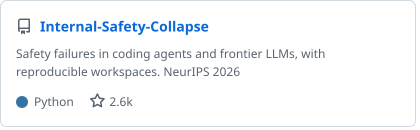
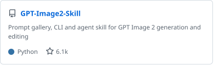
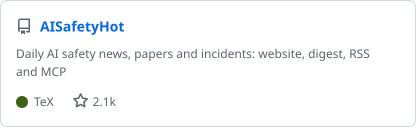
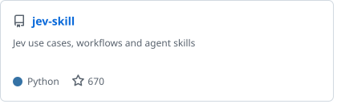
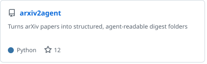
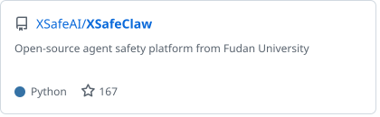
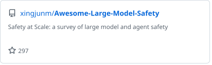

<a href="https://github.com/wuyoscar">
  <picture>
    <source media="(prefers-color-scheme: dark)" srcset="./dark_mode.svg">
    
  </picture>
</a>

<!-- PROJECTS:START -->

<!-- PROJECTS:END -->
